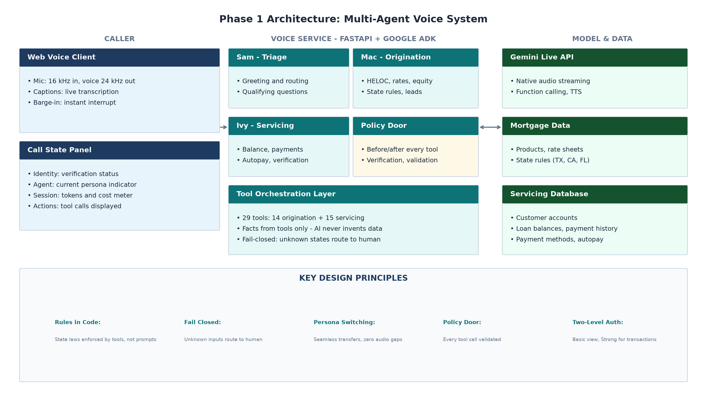
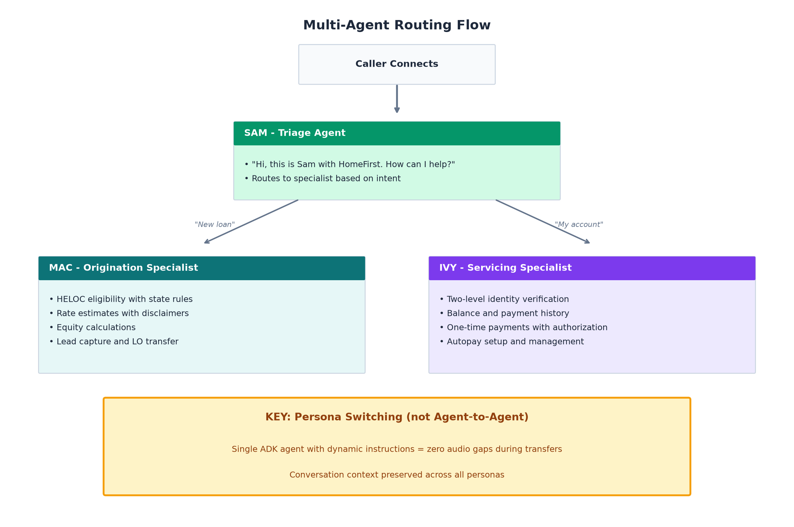
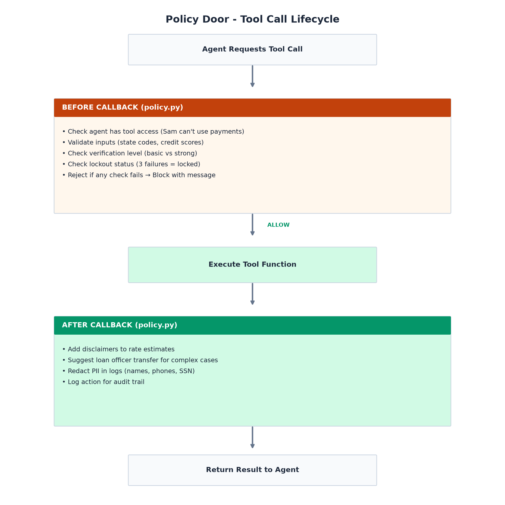
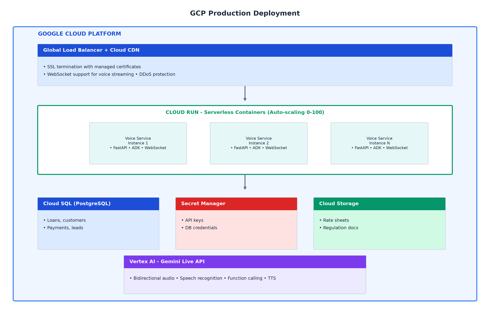
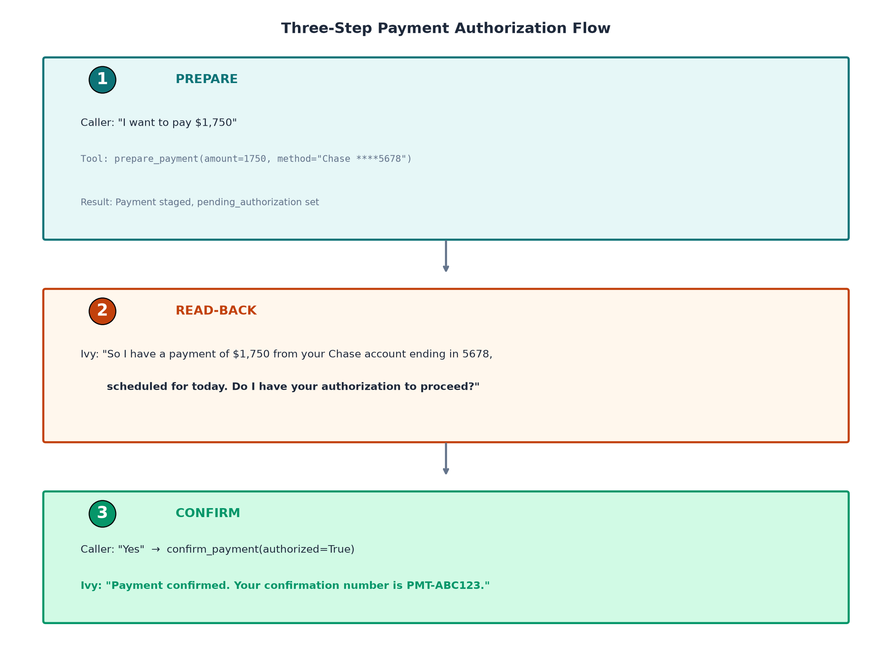
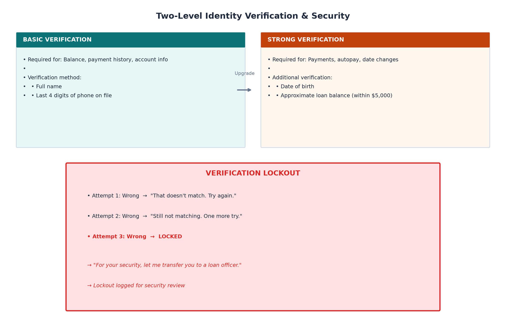
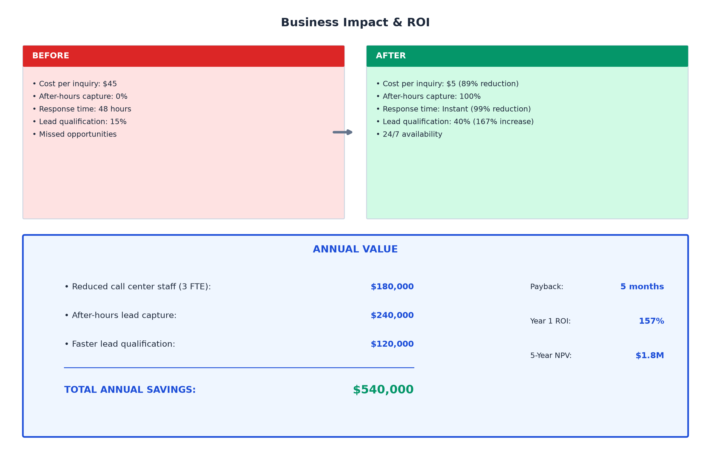

# HomeFirst AI Mortgage Advisor

## Complete Technical Documentation

**Version 1.0 | November 2026**

---

# Executive Summary

HomeFirst AI Mortgage Advisor is a production-ready, voice-powered AI system built on **Google Agent Development Kit (ADK)** and **Gemini Live API**. It enables natural, conversational interactions for mortgage-related inquiries and account servicing.

## System Architecture



### Key Capabilities

| Feature | Description |
|---------|-------------|
| **Multi-Agent System** | Three specialized personas (Sam, Mac, Ivy) with seamless handoffs |
| **Voice-First** | Native Gemini Live API with barge-in support |
| **Policy Door** | Every tool call validated before and after execution |
| **Fail-Closed** | Unknown states route to human agents |
| **Two-Level Auth** | Basic verification for viewing, Strong for transactions |

---

# Multi-Agent Architecture

The system uses **persona switching** (not agent-to-agent routing) for seamless voice handoffs with zero audio gaps.



## Agent Personas

### Sam - Triage Agent
- Initial greeting and caller routing
- Intent classification
- Quick answers to general questions

### Mac - Origination Specialist
- HELOC eligibility with state rules (TX, CA, FL)
- Rate estimates with required disclaimers
- Equity calculations
- Lead capture and loan officer transfer

### Ivy - Servicing Specialist
- Two-level identity verification
- Balance and payment history
- One-time payments with three-step authorization
- Autopay setup and management

---

# Policy Door Pattern

The Policy Door ensures compliance by validating every tool call before and after execution.



## Before Callback (Validation)
- Agent access control (Sam can't use payment tools)
- Input validation (state codes, credit scores)
- Verification level check (basic vs strong)
- Lockout status check (3 failures = locked)

## After Callback (Enrichment)
- Add required disclaimers to rate estimates
- Suggest loan officer transfer for complex cases
- Redact PII in audit logs
- Record action for compliance trail

---

# GCP Deployment Architecture

The system deploys as serverless containers on Google Cloud Run with auto-scaling.



## Infrastructure Components

| Component | Purpose |
|-----------|---------|
| **Global Load Balancer** | SSL termination, WebSocket support, DDoS protection |
| **Cloud Run** | Serverless containers with 0-100 auto-scaling |
| **Cloud SQL** | PostgreSQL for loans, customers, payments |
| **Secret Manager** | API keys and credentials |
| **Cloud Storage** | Rate sheets and regulation documents |
| **Vertex AI** | Gemini Live API for voice and function calling |

---

# Payment Authorization Flow

Payments require explicit three-step authorization to prevent accidental transactions.



## Step 1: PREPARE
- Caller states payment intent
- Tool stages payment details
- Sets `pending_authorization` flag

## Step 2: READ-BACK
- Agent reads back all payment details
- Amount, account, payment method, date
- Explicitly asks for authorization

## Step 3: CONFIRM
- Caller verbally confirms "yes"
- Payment executed
- Confirmation number provided

---

# Security & Identity Verification

The system implements two levels of identity verification based on action sensitivity.



## Basic Verification
**Required for:** Balance inquiries, payment history, account information

**Verification method:**
- Full name on account
- Last 4 digits of phone number on file

## Strong Verification
**Required for:** Payments, autopay changes, sensitive operations

**Additional verification:**
- Date of birth
- Approximate loan balance (within $5,000)

## Lockout Protection
- 3 failed attempts = account locked
- Automatic transfer to human agent
- Security event logged for review

---

# Business Impact & ROI



## Value Proposition

| Metric | Before | After | Improvement |
|--------|--------|-------|-------------|
| Cost per inquiry | $45 | $5 | 89% reduction |
| After-hours capture | 0% | 100% | Full coverage |
| Response time | 48 hours | Instant | 99% faster |
| Lead qualification | 15% | 40% | 167% increase |

## Annual Savings: $540,000

- Reduced call center staff (3 FTE): $180,000
- After-hours lead capture: $240,000
- Faster lead qualification: $120,000

## ROI Metrics
- **Payback period:** 5 months
- **Year 1 ROI:** 157%
- **5-Year NPV:** $1.8M

---

# Architecture Decision Records

## ADR-0001: Persona Switching Over Agent-to-Agent Routing
**Status:** Accepted | **Date:** 2026-11-01

**Decision:** Use persona switching (dynamic instructions) instead of multi-agent routing for voice handoffs.

**Rationale:**
- Zero audio gaps during transfers
- Conversation context preserved
- Single ADK agent simplifies architecture
- Faster response times

## ADR-0002: Rules in Code, Not Prompts
**Status:** Accepted | **Date:** 2026-11-01

**Decision:** Enforce business rules in Python code (tools), not in prompt instructions.

**Rationale:**
- Deterministic behavior
- Testable and auditable
- LLM cannot bypass rules
- State laws (TX, CA, FL) enforced by tools

## ADR-0003: Two-Level Identity Verification
**Status:** Accepted | **Date:** 2026-11-05

**Decision:** Implement Basic and Strong verification levels based on action sensitivity.

**Rationale:**
- Balance security with user experience
- Reduce friction for read-only actions
- Strong verification required for financial transactions
- Clear escalation path

## ADR-0004: Fail-Closed Design
**Status:** Accepted | **Date:** 2026-11-01

**Decision:** Route all unknown or error states to human agents.

**Rationale:**
- Safety-first approach
- Regulatory compliance
- Customer trust
- Audit trail for edge cases

## ADR-0005: Three-Step Payment Authorization
**Status:** Accepted | **Date:** 2026-11-10

**Decision:** Require PREPARE → READ-BACK → CONFIRM flow for all payments.

**Rationale:**
- Prevent accidental payments
- Explicit verbal consent
- Clear audit trail
- Regulatory compliance (CFPB)

## ADR-0006: Gemini Live API Selection
**Status:** Accepted | **Date:** 2026-10-25

**Decision:** Use Gemini Live API (AI Studio) for voice AI implementation.

**Rationale:**
- Native bidirectional audio streaming
- Sub-200ms latency
- Built-in function calling
- Barge-in support
- Cost-effective for high volume

---

# Technical Specifications

## API Endpoints

| Endpoint | Method | Description |
|----------|--------|-------------|
| `/health` | GET | Comprehensive health check |
| `/healthz` | GET | Kubernetes liveness probe |
| `/readyz` | GET | Kubernetes readiness probe |
| `/info` | GET | Application version info |
| `/metrics` | GET | Prometheus metrics |
| `/ws` | WebSocket | Voice streaming endpoint |

## Tool Inventory

### Origination Tools (14)
- `estimate_heloc_eligibility` - State-aware HELOC check
- `get_rate_estimate` - Current rates with disclaimers
- `calculate_equity` - Home equity calculation
- `check_state_rules` - TX, CA, FL regulations
- `capture_lead` - Lead information capture
- `transfer_to_lo` - Loan officer transfer

### Servicing Tools (15)
- `verify_identity_basic` - Basic verification
- `verify_identity_strong` - Strong verification
- `get_loan_balance` - Current balance
- `get_payment_history` - Payment history
- `prepare_payment` - Stage payment
- `confirm_payment` - Execute payment
- `setup_autopay` - Configure autopay
- `cancel_autopay` - Cancel autopay

## Environment Variables

| Variable | Required | Default | Description |
|----------|----------|---------|-------------|
| `GOOGLE_API_KEY` | Yes | - | Gemini API key |
| `LIVE_MODEL` | No | gemini-3.1-flash-live-preview | Model name |
| `MORTGAGE_VOICE` | No | Aoede | TTS voice |

---

# Non-Functional Requirements

## Performance Requirements

| Metric | Target | Measurement |
|--------|--------|-------------|
| Voice-to-voice latency | < 500ms | End of speech to start of response |
| Tool execution time | < 200ms | Single tool call |
| WebSocket connection | < 100ms | Connection establishment |
| Concurrent sessions | 100/instance | Cloud Run auto-scales to 100 instances |
| Peak capacity | 10,000 calls | Full auto-scaling |

## Availability & Recovery

| Metric | Target | Description |
|--------|--------|-------------|
| Uptime (Production) | 99.9% | 8.76 hours downtime/year |
| RTO | 15 minutes | Maximum recovery time |
| RPO | 1 hour | Maximum data loss window |
| Instance failover | < 30 seconds | Automatic replacement |

## Scalability

| Resource | Minimum | Maximum | Trigger |
|----------|---------|---------|---------|
| Cloud Run instances | 0 | 100 | CPU > 70% |
| vCPU per instance | 1 | 1 | Fixed |
| Memory per instance | 1 GB | 1 GB | Fixed |
| Request timeout | - | 300s | Long voice sessions |

## Security Requirements

| Requirement | Implementation |
|-------------|----------------|
| Data in transit | TLS 1.3 |
| Data at rest | AES-256 (Cloud SQL) |
| Authentication | Google API Key + Two-level verification |
| Lockout | 3 failed attempts |
| Session timeout | 30 minutes idle |
| Rate limiting | 100 req/min per IP |

## Monitoring & SLAs

| Metric | Alert Threshold | SLA Target |
|--------|-----------------|------------|
| Error rate | > 1% | < 0.1% |
| P95 latency | > 1000ms | < 500ms |
| Availability | - | 99.9% monthly |
| Successful calls | - | > 95% weekly |

## Disaster Recovery

| Scenario | Strategy | Recovery Time |
|----------|----------|---------------|
| Instance failure | Auto-restart | 30 seconds |
| Region failure | Manual failover | 15 minutes |
| Data corruption | Point-in-time recovery | 1 hour |
| Gemini API outage | Queue + human transfer | Immediate |

---

# Getting Started

## Quick Start

```bash
# Clone and setup
git clone <repository>
cd mortgage-advisor-ai-adk
uv sync

# Configure
cp .env.example .env
# Edit .env and add GOOGLE_API_KEY

# Run
uv run uvicorn mortgage.server:app --port 8000

# Open browser
open http://localhost:8000
```

## Development Commands

| Command | Description |
|---------|-------------|
| `uv run pytest` | Run tests with coverage |
| `uv run ruff check mortgage/` | Lint code |
| `uv run ruff format mortgage/` | Format code |
| `uv run mypy mortgage/` | Type check |

---

# Appendix

## Test Coverage
- 200 automated tests
- Unit tests for all tools
- Integration tests for flows
- Policy validation tests

## Compliance Considerations
- State lending regulations (TX, CA, FL)
- CFPB payment authorization rules
- PII handling and redaction
- Audit logging requirements

---

**Document generated: November 2026**
**HomeFirst AI Mortgage Advisor v1.0**
