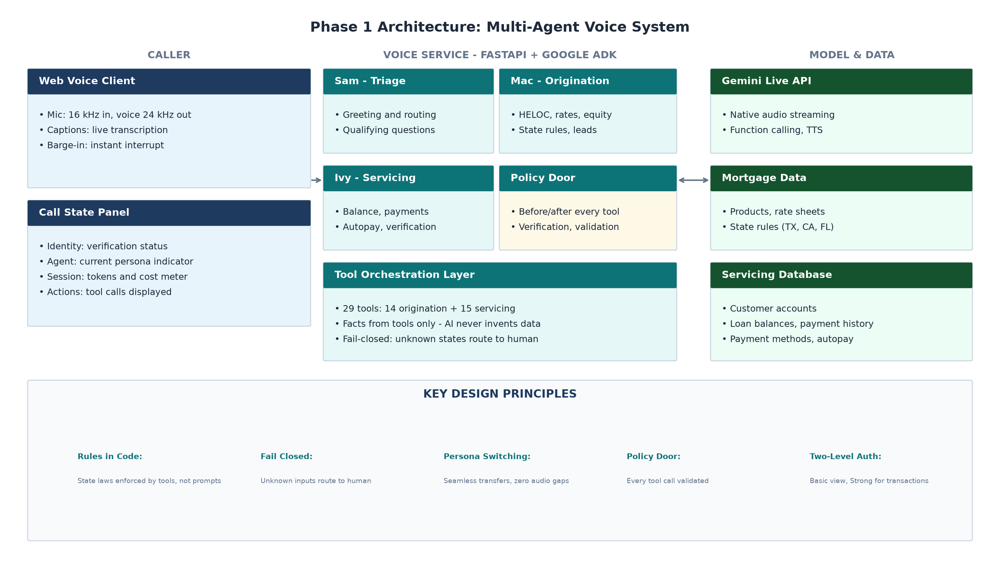
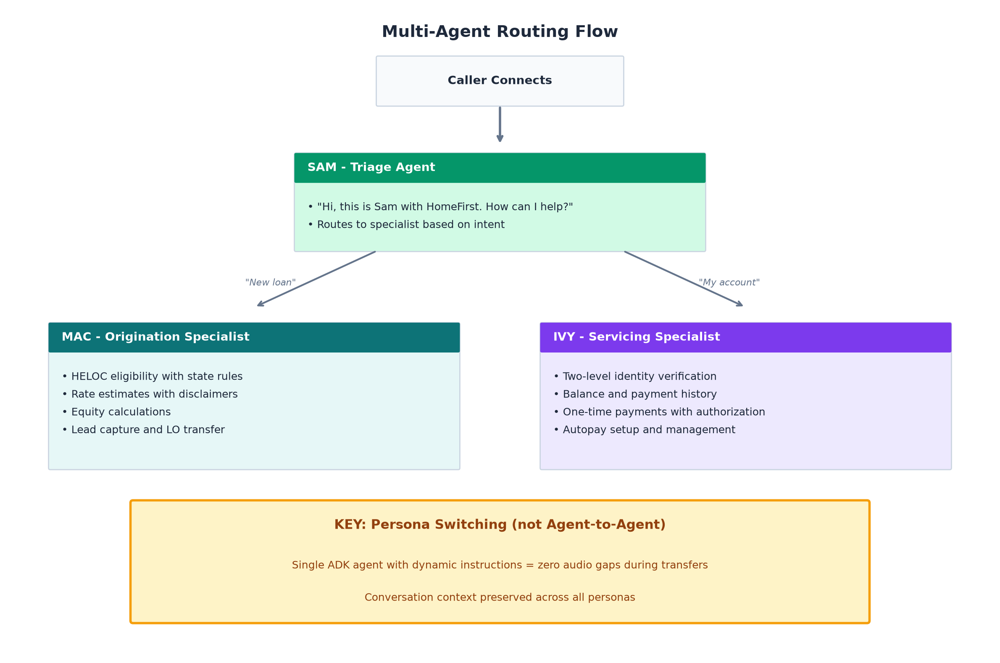
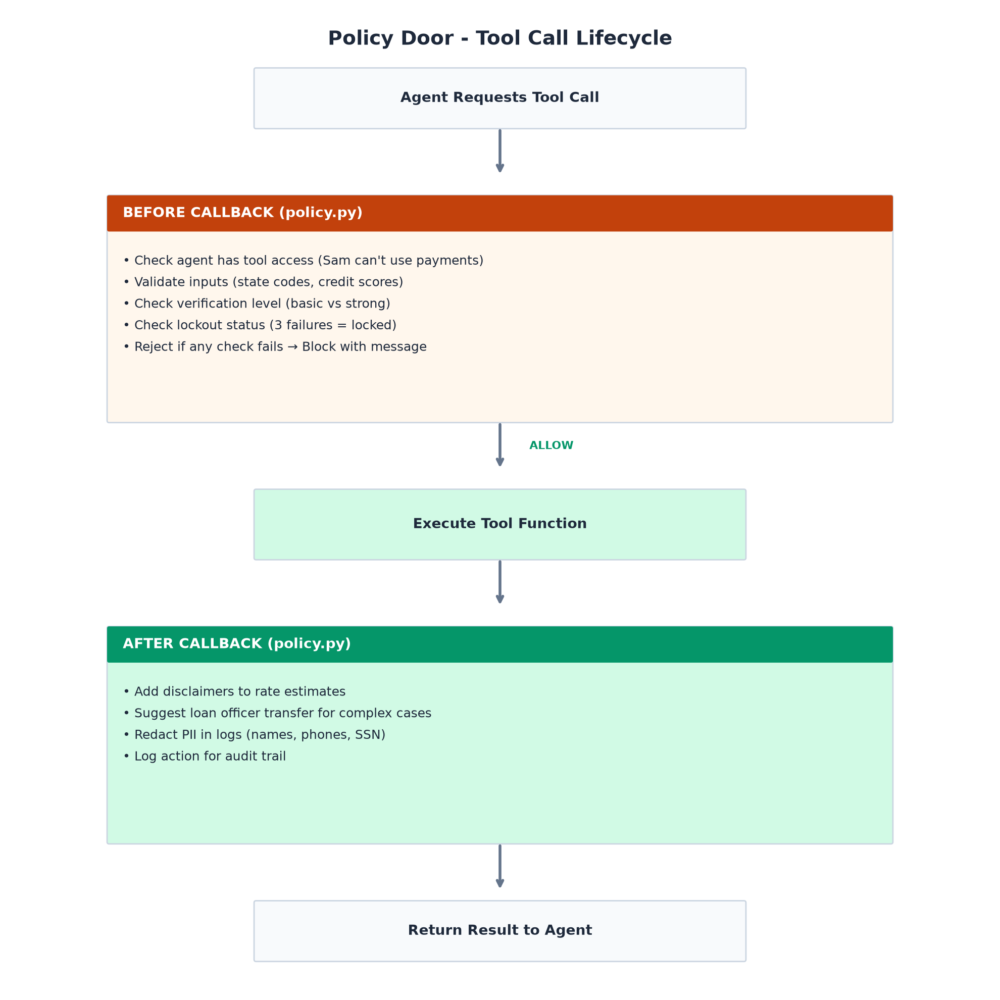
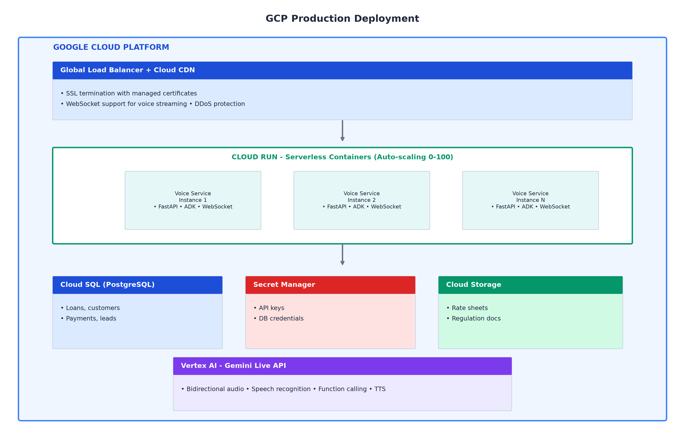
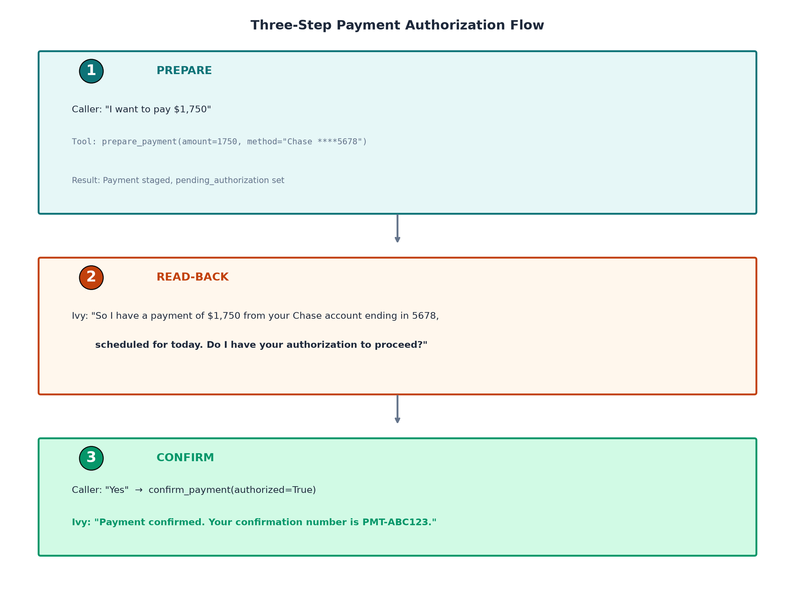
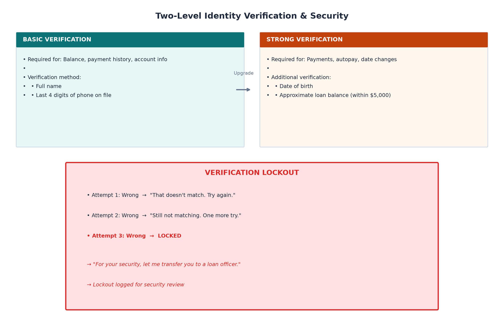
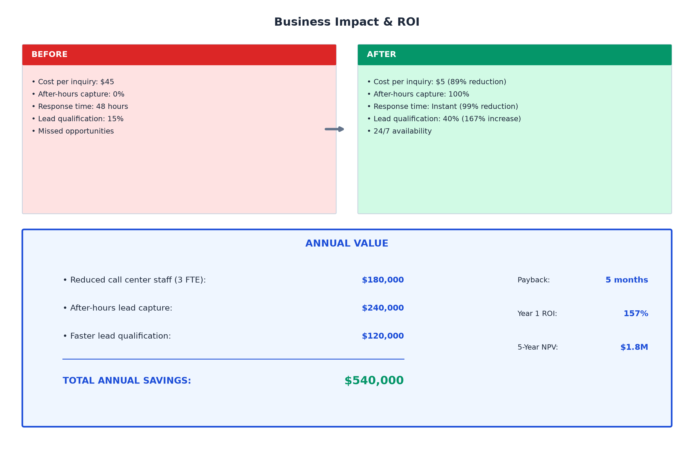

# Executive Overview

**HomeFirst AI Mortgage Advisor**

Voice-powered AI assistant built on Google ADK & Gemini Live API

- Multi-agent system (Sam, Mac, Ivy)
- Policy-enforced compliance
- Two-level identity verification
- 24/7 availability

---

# The Challenge

**Traditional Mortgage Call Centers**

- High cost per inquiry: $45
- After-hours: Missed opportunities
- Response time: Up to 48 hours
- Compliance risks: Human error

---

# The Solution

**AI-Powered Voice Assistant**

- Natural voice conversations
- Instant responses 24/7
- Automated compliance enforcement
- Seamless human handoff

---

# System Architecture

---

# Multi-Agent Flow

---

# Agent Personas

**Sam - Triage Agent**

- Initial greeting and routing
- Intent classification
- Quick answers

**Mac - Origination**

- HELOC eligibility
- Rate estimates
- State rules (TX, CA, FL)

**Ivy - Servicing**

- Identity verification
- Balance inquiries
- Payment processing

---

# Policy Door Pattern

---

# Key Design Principles

**Rules in Code, Not Prompts**

- State laws enforced by tools
- Deterministic behavior
- Fully testable

**Fail-Closed Design**

- Unknown states route to human
- Safety-first approach
- Audit trail for all actions

---

# GCP Deployment

---

# Payment Authorization

---

# Three-Step Payment Flow

**Step 1: PREPARE**

Caller: "I want to pay $1,750"

**Step 2: READ-BACK**

Agent: "Payment of $1,750 from Chase ****5678. Do I have your authorization?"

**Step 3: CONFIRM**

Caller: "Yes" - Payment executed

---

# Security Model

---

# Verification Levels

**Basic Verification**

- Balance inquiries
- Payment history
- Account information

**Strong Verification**

- Payment processing
- Autopay changes
- Sensitive operations

---

# Business Impact

---

# Key Metrics

| Metric | Improvement |
|--------|-------------|
| Cost per inquiry | 89% reduction |
| After-hours capture | 0% to 100% |
| Response time | 99% faster |
| Lead qualification | 167% increase |

---

# Financial Summary

**Annual Savings: $540,000**

- Call center reduction: $180,000
- After-hours capture: $240,000
- Lead qualification: $120,000

**ROI**

- Payback: 5 months
- Year 1 ROI: 157%
- 5-Year NPV: $1.8M

---

# Technology Stack

**Google Cloud Platform**

- Gemini Live API (Voice AI)
- Cloud Run (Serverless)
- Cloud SQL (PostgreSQL)

**Application**

- Python 3.13 + FastAPI
- Google ADK
- WebSocket streaming

---

# Compliance & Security

**Regulatory**

- State lending rules (TX, CA, FL)
- CFPB payment authorization
- PII redaction

**Security**

- Two-level verification
- Lockout protection
- Audit logging

---

# Next Steps

1. Pilot deployment
2. User acceptance testing
3. Compliance review
4. Production rollout

---

# Thank You

**HomeFirst AI Mortgage Advisor**

Voice AI for Modern Lending

Questions?
